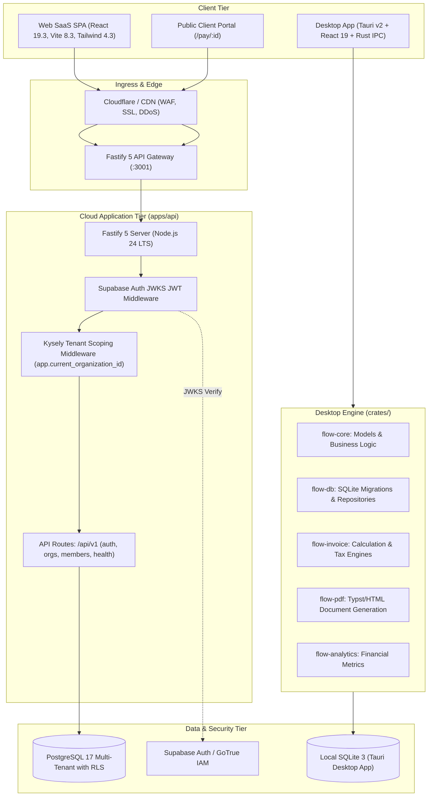

# InvoiceFlow — System Architecture & Design

## 1. High-Level System Architecture

InvoiceFlow is a hybrid financial operating platform supporting two operational tiers:
1. **Cloud-Native Multi-Tenant SaaS:** Built on Node.js 24 + Fastify 5, React 19 + Vite 8, and PostgreSQL 17 with fail-closed Row Level Security (RLS) managed via Kysely.
2. **Local-First Desktop Command Center:** Built with Tauri v2, Rust core crates (`crates/flow-*`), SQLite embedded database, and React 19 UI with zero cloud dependencies for offline operations.



---

## 2. Technology Stack

### 2.1 Web & SaaS Frontend (`apps/web`)
- **Framework:** React 19.3, Vite 8.3, TypeScript 5.8 (Strict Mode)
- **Styling:** Tailwind CSS 4.3, Lucide React icons
- **Server State Management:** TanStack Query v5 (`@tanstack/react-query`) with automatic cache deduplication, optimistic mutations, and window focus revalidation
- **Local UI State:** Zustand v5 (`zustand`) strictly scoped to transient UI state (sidebar open/close, active modal, dropdowns)
- **Routing:** React Router DOM v7
- **Testing:** Playwright E2E browser tests

### 2.2 Cloud API Backend (`apps/api`)
- **Runtime:** Node.js 24 LTS
- **Framework:** Fastify 5 (`fastify@5.2.1`)
- **Authentication:** Asymmetric JWKS JWT verification via `@fastify/jwt` & `jwks-rsa`
- **Tenant Isolation:** Fastify middleware injecting `app.current_organization_id` into scoped PostgreSQL transactions
- **Query Builder & ORM:** Kysely (`kysely`) with `pg` connection pooling
- **Validation:** TypeBox / JSON Schema
- **Testing:** Vitest (`vitest`) with 40+ unit/integration/isolation tests

### 2.3 Data Platform & Migrations (`packages/db`)
- **Engine:** PostgreSQL 17 (Supabase Managed or Local Docker)
- **Migration Engine:** Forward-only idempotent migration runner (`packages/db/src/migrate.ts`) tracking applied scripts in `public._migrations`
- **Row-Level Security:** Strict fail-closed RLS on all tenant tables (`organizations`, `organization_members`, `invoices`, `clients`, `items`)
- **Session Variable:** `app.current_organization_id` enforced in database policies

### 2.4 Desktop Application (`apps/desktop` & `crates/`)
- **Shell:** Tauri v2 (`@tauri-apps/api`, `@tauri-apps/plugin-*`)
- **Backend Language:** Rust 2021 Edition
- **Crates:**
  - `crates/flow-core`: Shared financial domain types, errors, calculation traits
  - `crates/flow-db`: SQLite migration runner, connection pool, repository pattern
  - `crates/flow-invoice`: Line-item tax/discount calculators, invoice number sequencers
  - `crates/flow-pdf`: Template rendering engine (HTML/Typst/Chromium)
  - `crates/flow-analytics`: Cashflow velocity, client lifetime value calculations

---

## 3. Data Models & Database Schemas

### 3.1 Multi-Tenant PostgreSQL Schema (`packages/db`)

```sql
-- Core Organizations (Tenants)
CREATE TABLE public.organizations (
    id UUID PRIMARY KEY DEFAULT gen_random_uuid(),
    name VARCHAR(255) NOT NULL,
    slug VARCHAR(255) UNIQUE NOT NULL,
    currency VARCHAR(3) NOT NULL DEFAULT 'USD',
    tax_rate NUMERIC(5, 2) NOT NULL DEFAULT 0.00,
    created_at TIMESTAMPTZ NOT NULL DEFAULT NOW(),
    updated_at TIMESTAMPTZ NOT NULL DEFAULT NOW()
);

-- Organization Memberships with Roles (owner, admin, member, viewer)
CREATE TABLE public.organization_members (
    id UUID PRIMARY KEY DEFAULT gen_random_uuid(),
    organization_id UUID NOT NULL REFERENCES public.organizations(id) ON DELETE CASCADE,
    user_id UUID NOT NULL,
    role VARCHAR(50) NOT NULL CHECK (role IN ('owner', 'admin', 'member', 'viewer')),
    invited_by UUID,
    created_at TIMESTAMPTZ NOT NULL DEFAULT NOW(),
    UNIQUE(organization_id, user_id)
);

-- Row Level Security (RLS) Fail-Closed Policy Pattern
ALTER TABLE public.organizations ENABLE ROW LEVEL SECURITY;
ALTER TABLE public.organizations FORCE ROW LEVEL SECURITY;

CREATE POLICY tenant_isolation_policy ON public.organizations
    FOR ALL
    USING (id = NULLIF(current_setting('app.current_organization_id', true), '')::uuid);
```

### 3.2 Desktop SQLite Schema (`crates/flow-db`)
- `clients`: ID, company name, contact email, billing address, tax identifier
- `invoices`: ID, invoice number, issue date, due date, status (draft, sent, paid, overdue), currency, subtotal, tax amount, discount amount, total amount
- `invoice_items`: ID, invoice_id, description, quantity, unit_price, tax_rate, amount
- `business_profiles`: Default currency, company details, logo path, statutory tax numbers

---

## 4. API Endpoints Specification (`apps/api`)

All `/api/v1/*` endpoints (except health and webhooks) require `Authorization: Bearer <JWT>` header and optionally `x-organization-id: <uuid>`.

| Route | Method | Auth Required | Description |
|---|---|---|---|
| `/health` | GET | No | Liveness and database connectivity health probe |
| `/api/v1/auth/me` | GET | Yes | Returns authenticated user identity and organization memberships |
| `/api/v1/organizations` | GET | Yes | Lists organizations the authenticated user belongs to |
| `/api/v1/organizations` | POST | Yes | Creates a new organization; assigns caller as `owner` |
| `/api/v1/organizations/:id` | GET | Yes | Retrieves organization details (scoped by membership) |
| `/api/v1/organizations/:id` | PATCH | Yes | Updates organization configuration (admin/owner only) |
| `/api/v1/organizations/:id/members` | GET | Yes | Lists all members within the target organization |
| `/api/v1/organizations/:id/members` | POST | Yes | Invites/adds a member to the organization |
| `/api/v1/organizations/:id/members/:userId` | DELETE | Yes | Removes a member from the organization |
| `/pay/:id` | GET | No | Public customer invoice preview and payment portal |
| `/api/v1/webhooks/stripe` | POST | Signature | Stripe payment webhook ingestion |
| `/api/v1/webhooks/razorpay` | POST | Signature | Razorpay payment webhook ingestion |

---

## 5. Security & Isolation Architecture

1. **Defense-in-Depth Tenant Isolation:**
   - **Application Layer:** Fastify middleware extracts the target organization ID, verifies membership via `organization_members`, and sets tenant context.
   - **Database Layer:** PostgreSQL `FORCE ROW LEVEL SECURITY` rejects any query that does not set `app.current_organization_id`.
2. **Asymmetric JWT Verification:**
   - Supabase Auth issues RSA/ECDSA-signed JWTs. The Fastify API downloads public keys via JWKS and verifies tokens locally with 0 round-trips to Auth servers.
3. **Audit Ledger:**
   - Forward migrations are tracked in `public._migrations` with SHA-256 checksums to prevent migration drift or uncommitted changes.


## Verified development foundation — 12 October 2026

The developer setup is now documented in docs/development-setup.md. Node 24.21.0, Bun 1.4.3 and Rust 1.99.0 were used for verification. Actual SaaS Vite build is 6.4.4 and desktop Vite is 6.4.1; earlier Vite 8 statements above describe an unverified target, not installed implementation. Root lockfile includes Linux native optional packages. Test-only PostgreSQL 18 runs in a disposable local cluster, with test-mode dotenv loading disabled. No application API/data-model architecture was changed in this foundation task. Historical schema/endpoint assertions above still require source reconciliation before product planning.
